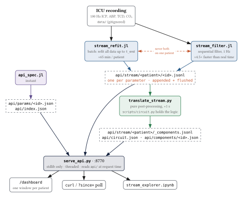
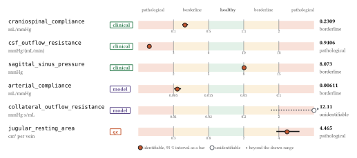
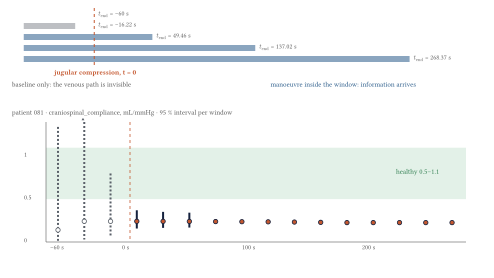
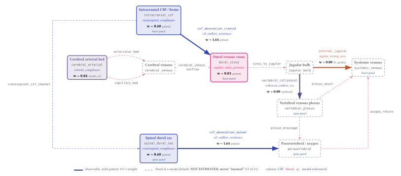
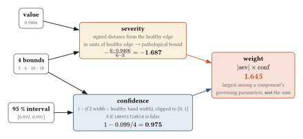
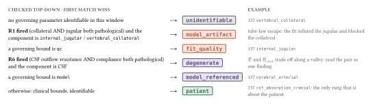
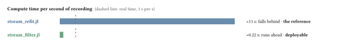

# ICP parameter API

A streaming estimator for six physiologically interpretable parameters of cerebral
CSF/venous dynamics. It fits them from an intracranial pressure recording and serves them
over HTTP with confidence intervals and four bounds each, both raw and translated into
weights on the parts of the circuit.

Extracted from the `brainphysio_celia` research repository (`Model_6`), 2026-08-26.

> [!WARNING]
> **Patient data is not in this repository.** `data/` is gitignored. The estimator needs four
> de-identified 100 Hz ICU recordings (ICP, ABP, transcranial doppler, CO₂). Restore them with
> `bash scripts/setup_data.sh /path/to/brainphysio_celia`. If you ever `git add -f data/`, the
> repository **must stay private**.

> [!WARNING]
> **There are no healthy controls.** All four recordings are ICU patients. Every "healthy"
> bound is from literature, not from a control group measured with this pipeline. This is
> the weakest assumption in the project.

The diagrams are Typst, defined in [figures/readme/figs.typ](figures/readme/figs.typ) and
rendered by `bash scripts/build_readme_figures.sh`. The numbers in them were read off `api/`
on 2026-10-14; they do not update after a refit. The same figures with the full text are in
[reports/readme_diagrams.pdf](reports/readme_diagrams.pdf).

---

## 1 · The pipeline



The API is **file-backed**. The estimator appends one JSON object per window and flushes;
the server reads `api/` at request time. A refit still in progress is therefore served live,
`?since=<t>` returns only what is new, and an already-running server always serves current
data. `translate_stream.py` is pure post-processing, so the component view can be
regenerated in a second without redoing a refit.

**Two writers corrupt a stream.** Both estimators open the same `.jsonl` with `"w"`, so they
must never run at once on one patient. Stream `083` was once truncated to 0 records this way.
If a stream shrinks or `t_end` jumps backwards, that is what happened (RULEBOOK R9).

| what | command | cost |
|---|---|---|
| parameter metadata + index | `julia --project=. model/api_spec.jl` | instant |
| component view | `python3 scripts/translate_stream.py` | ≈1 s |
| one patient, sequential filter | `_PATIENT=081 julia --project=. model/stream_filter.jl` | ≈90 s |
| one patient, batch refit | `_PATIENT=081 _NWIN=16 _WIN_ITERS=45 julia --project=. model/stream_refit.jl` | ≈65 min |
| all four, batch refit | `bash model/stream_all.sh 16 45` | ≈70 min (parallel) |

Validate before serving. If this exits non-zero, the server will still start and serve
something wrong:

```console
$ python3 scripts/serve_api.py --check
index: 6 params, 4 patients

  craniospinal_compliance          [0.1, 0.5, 1.1, 2.0]         [clinical]
  csf_outflow_resistance           [3.0, 6.0, 10.0, 18.0]       [clinical]
  arterial_compliance              [0.005, 0.015, 0.05, 0.1]    [model]
  collateral_outflow_resistance    [0.01, 0.02, 0.2, 2.0]       [model]
  jugular_resting_area             [0.3, 0.8, 2.0, 4.0]         [qc]
  sagittal_sinus_pressure          [2.0, 5.0, 8.0, 15.0]        [clinical]

  patient 081: 96 records
  ...
circuit: 9 compartments + 12 interfaces, 8 observable
  patient 137: 16 windows, lead csf_absorption_cranial w=1.64 (patient)   rules=-
```

---

## 2 · Six parameters, four bounds each



Four bounds per parameter split its axis into five zones. In the figure each bound sits one
unit from the next, so horizontal distance *is* the `severity` that §5 turns into a weight.
The values shown are patient 137's last window.

The **provenance tag** says how far the bounds can be trusted. It is not decorative:

| tag | meaning |
|---|---|
| `clinical` | a published human reference range for a directly measured quantity |
| `model` | **no** human range exists; the bounds are anchored on the source model's default, so they describe the model, not physiology. **Never present these to a clinician as normal ranges.** |
| `qc` | a check on the fit, not a property of the patient. The fit drives the jugular to 5–12 cm² against a physiological 0.8–2.0, a known artefact of the model. A value out of band says the **fit** is wrong. A bedside ultrasound falsifies it in thirty seconds, which makes it the best quality-control channel in the set. |

```console
$ curl -s http://127.0.0.1:8770/latest/137      # one of six entries
"csf_outflow_resistance": {
  "value": 0.940584, "ci_lo": 0.892404, "ci_hi": 0.991365,
  "status": "pathological", "identifiable": true, "t_end": 268.62,
  "unit": "mmHg/(mL/min)", "healthy_range": [6.0, 10.0],
  "bound_provenance": "clinical", "n_records": 16
}
```

---

## 3 · Read `identifiable` first



The window **expands**. At each step the model is refitted on all mean-ICP data from the
start of the recording up to `t_end`, then `t_end` moves forward. Each record answers the
question *"what would we have estimated, knowing only what had happened by now?"*, which is
what a bedside monitor could have shown at that instant. The window does not slide, because
the model is an initial-value problem: every evaluation integrates from the start anyway.

Resting ICP is nearly blind to the venous outflow path. The sensitivity
`|∂log ICP_baseline / ∂log θ|` is **0.0000** for the collateral resistance and **0.0004**
for the jugular tube law. Before the compression enters the window, those parameters are
guessed, not estimated:

```console
$ curl -s http://127.0.0.1:8770/stream/081/jugular_resting_area     # first and last window
{"t_end": -38.11, "value": 6.16555, "ci_lo": 5.66e-275, "ci_hi": 6.71e+275,
 "status": "unidentifiable", "identifiable": false, "rmse": 0.1667, "n_solves": 92}
 ...
{"t_end": 268.37, "value": 6.1156,  "ci_lo": 5.07058,   "ci_hi": 7.37598,
 "status": "pathological",   "identifiable": true,  "rmse": 0.7261, "n_solves": 73}
```

An interval spanning 550 orders of magnitude narrows to a factor of 1.5. Emitted as a bare
number, the first record would look like a measurement but would be fiction. Every record
therefore carries a Fisher-information interval and an `identifiable` flag (fractional
σ < 0.5). `status` is `unidentifiable` whenever the flag is false, whatever zone the point
estimate falls in. **Watching the intervals collapse is the intended use of this API**, more
than any single value. Note also that the jugular value which does collapse, 6.1 cm², is
the known fit artefact (`qc`): it is precise and wrong.

---

## 4 · The circuit: 21 components, 8 observable



The six parameters are coordinates of the model, not places in the head. `E` is a
coefficient in a compliance law, and `Ro_tot` is one lumped resistance split two ways.
`GET /circuit` translates them into **9 compartments** (pressure nodes) and **12
interfaces** (flow elements, `frm → to`). Compartments that carry a `hydrostatic_panel`
follow the plotter's `build_tilt_panels` in the source repo:

| panel | drawn against | compartments |
|---|---|---|
| `tilt_pressures_heart` | heart→brain column `Hs_Rvvs.Δp` | Pic, Psinus, Psys |
| `tilt_pressures_spine` | spine column `Hs_Revp.Δp` | Pds, Po_spine, Pivp, Pevp |

> [!IMPORTANT]
> **An absent weight means NOT ESTIMATED, never normal.** Only 8 of the 21 components are
> governed by a streamed parameter. The other 13 are fixed at model defaults and are listed
> only so the topology is complete.

---

## 5 · From a parameter to a weight



- **severity** is piecewise linear on purpose: "how many bands out" has to be arithmetic a
  clinician can check. It is 0 inside the healthy band and ±1 at a pathological bound, and
  its sign gives `direction`.
- **confidence** is 0 when the interval is wider than the healthy band, since such an
  interval cannot say which side of the band the value is on. In 137,
  `jugular_resting_area` is `pathological` (severity +1.23), but its interval is 1.32 cm²
  wide against a 1.2 cm² band, so `internal_jugular` gets **w = 0.00**. That zero comes from
  the interval width, not from the jugular being healthy.
- **weight** is the *largest* discounted excursion among a component's parameters, not the
  sum: two parameters mildly out is not evidence of one severely abnormal component. A
  weight is **not a probability**, and not necessarily a claim about the patient.

`attribution` says whether a weight is about the patient or about the fit:



R1 and R6 are implemented in `scripts/circuit.py`. The other RULEBOOK rules need cross-window
or raw-θ context and are left to the reader, so **read [RULEBOOK.md](RULEBOOK.md) before
interpreting any number**.

```console
$ curl -s http://127.0.0.1:8770/components/137/latest     # lead component, ranked by weight
{ "patient": "137",
  "window": { "t_end": 268.62, "n_parameters": 6, "rules_fired": [], "components": [
    { "component": "csf_absorption_cranial", "weight": 1.6447, "direction": "low",
      "attribution": "patient",
      "attribution_reason": "clinical bounds, identifiable in this window",
      "lead_parameter": "csf_outflow_resistance",
      "contributions": [ { "param": "csf_outflow_resistance", "severity": -1.6865,
          "confidence": 0.9753, "role": "conductance", "value": 0.940584,
          "status": "pathological", "identifiable": true } ] },
    ... 7 more ] } }
```

### What the four patients show, read sceptically

Every patient leads with `csf_absorption_cranial` / `csf_absorption_spinal` at weight
1.1–1.7, direction `low`, because `csf_outflow_resistance` is below its clinical floor in all
four. Abnormally *low* CSF outflow resistance is the opposite of the NPH/IIH pattern, and in
the static prefit 137 and 150 had `Ro_tot` pinned at a search bound. The cause may be the
0.069 / 0.931 cranial/spinal split rather than the patients.

081 is the only patient where **R1 fires**, so its jugular and collateral weights are
`model_artifact` and should not be read clinically.

---

## 6 · Two estimators



| | `stream_refit.jl` (batch, **the reference**) | `stream_filter.jl` (sequential, **the deployable one**) |
|---|---|---|
| method | refit the whole recording at each `t_end` | joint state + parameter filter, one step per sample |
| cost / record | ≈55 full integrations, ≈2.5 min | 39 one-second integrations, ≈0.2 s |
| resolution | as many windows as you can afford | every sample, 1 Hz |
| interval | Fisher information at a converged optimum | filter covariance, *given an assumed process noise* |
| parameters | constant within a window | random walk (`_QTHETA`) |

**The batch fit cannot be made incremental, and this is not an implementation problem.** The
six quantities are structural parameters of the ODE: changing `E` changes the trajectory from
the first step. Every candidate therefore costs a fresh integration of the whole recording,
≈62 million RK4 steps per emitted record.

**The filter's failure mode:** set `_QTHETA` too high and the filter explains genuine model
error by letting the parameters wander. The stream will look responsive and mean nothing.
Where the two disagree, the batch fit is the one this README's numbers refer to.

---

## 7 · Running it

```bash
bash scripts/setup_data.sh /path/to/brainphysio_celia   # fetch recordings
julia --project=. -e 'using Pkg; Pkg.instantiate()'     # only dependency is Optim
julia --project=. model/api_spec.jl                     # -> api/params/*.json
_PATIENT=081 julia --project=. model/stream_filter.jl   # -> api/stream/081/*.jsonl  (≈90 s)
python3 scripts/translate_stream.py                     # -> component view (≈1 s)
python3 scripts/serve_api.py --check                    # validate first
python3 scripts/serve_api.py                            # http://127.0.0.1:8770
```

The server is standard library only, so no venv is needed. For a **standing watch**, open
`http://127.0.0.1:8770/dashboard`, one window per patient if you like. A polling cell in
`notebooks/stream_explorer.ipynb` blocks that notebook's whole kernel; the dashboard does not.

### Routes

```
GET /                                    index: parameters, patients, route templates
GET /params            /params/<id>      metadata + the four bounds
GET /stream/<p>/<id>?since=<t>           raw stream; ?since returns only t_end > t
GET /latest/<p>                          most recent value of every parameter
GET /circuit                             the segmentation
GET /components        /components/<id>  component metadata
GET /components/<p>/latest               most recent window, ranked by weight
GET /components/<p>/stream?since=<t>     weights per window
GET /dashboard                           standing-watch page
```

`<p>` is one of `081 083 137 150`. `081_batch` and `081_filter` are also on disk but are
different experiments, not the canonical refit. Patient ids are strings, because
`float("081") == 81.0`.

### Things that bite

- **Port 8770 already in use.** A server from an earlier session is usually still running.
  It is stateless and file-backed, so reuse it:
  ```console
  $ python3 scripts/serve_api.py
  port 8770 is already in use
    held by pid 34833: python3 scripts/serve_api.py
    reuse it:  curl -s http://127.0.0.1:8770/
    or stop it: kill 34833
    or pick another port:  scripts/serve_api.py --port 8771
  ```
- **Don't `pkill -f serve_api`.** The pattern matches your own command line and kills the caller.
- **`nohup … &` inside a one-shot shell does not persist.** Start the server as a proper background task.
- **`model/api_spec.jl` rewrites `api/index.json`**, including the component route block. A
  route added only by hand is dropped at the next regeneration.

---

## Layout

```
model/ude_cv.jl              13-state compact model of the craniospinal circuit (RK4, ≈2.5 s/solve)
model/api_spec.jl            writes api/params/*.json and api/index.json — the bounds contract
model/stream_contract.jl     what both estimators must agree on: bounds, derivations, record bytes
model/stream_refit.jl        expanding-window refitter (batch, the reference)
model/stream_filter.jl       sequential joint state-parameter filter (faster than real time)
model/stream_all.sh          all four patients in parallel
fit/*_compact.jl             per-patient starting parameters
scripts/circuit.py           segmentation + translation logic (severity, confidence, R1/R6)
scripts/translate_stream.py  generates the component view
scripts/serve_api.py         HTTP server, standard library only
scripts/setup_data.sh        copy recordings from the source repository
scripts/build_readme_figures.sh  figures/readme/figs.typ -> figures/readme/*.svg
web/dashboard.html           standing-watch page served at /dashboard
api/params/*.json            generated metadata (committed — it is the contract)
api/stream/                  generated streams (gitignored)
data/                        patient recordings (gitignored)
```

## Known limitations

1. **No healthy controls** (above). This is the single largest caveat.
2. **n = 4**: one manoeuvre each, one model.
3. **The model overestimates the ICP pulse amplitude under jugular compression by ≈7×.** The
   cause is diagnosed: the fit inflates the jugular to ≈205 mL, which makes it the model's
   dominant beat-scale buffer, and the compression then removes it. This is why
   `jugular_resting_area` is `qc`. `craniospinal_compliance` and `csf_outflow_resistance` are
   fitted against the *mean* ICP response and are not directly implicated, but the coupling
   has not been ruled out.
4. **Some fitted values sit on search bounds** in the source fits (patient 137 had three). A
   value at a bound is not an estimate; the confidence interval is the way to detect it.
5. **`sagittal_sinus_pressure` as a negative control is provisional.** It was the one
   parameter that stayed in range across all four static fits, but under expanding-window
   refitting it reaches 8.07–8.33 mmHg (borderline).
